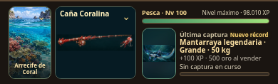
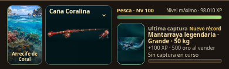

# Estable 29 · pulido de Pesca

Base: Estable 28 (`590bcd6`). Se conservan 13 zonas, 50 especies, 50 ofertas de cañas y los 37 encargos existentes. No se agrega contenido ni se sustituye masivamente el catálogo.

## Cambios

- Paisaje y colección comparten un panel. La descripción secundaria pasa al paisaje, sin otra fila debajo del selector. No se superponen peces al centro del paisaje. La colección conserva su desplegable y adaptación móvil. Laguna Esmeralda deja de repetir el nivel 22 en su descripción; su acceso sigue requiriendo ese nivel.
- Insignia de colección en el extremo derecho del encabezado: sello con la ilustración propia de cada región, estado **Obtenida** o botón **Reclamar insignia**, también con la colección cerrada. Se elimina el bloque grande y la aclaración «Premio visual, sin oro». Los sellos reutilizan los trece paisajes existentes; se distinguen de las trece medallas escultóricas de maestría, que se conservan.
- Encargos en un desplegable con cabecera propia. Pendientes primero y completados después, con miniatura de recompensa y detalles al abrir la fila. Los completados no quedan oscurecidos. Se mantienen los controles y validaciones originales de entrega/reclamo.
- **A partir de esta versión, los encargos pendientes no entregan oro.** Los siete encargos de expansión que lo otorgaban entregan su insignia; los demás conservan cañas y mejoras ya previstas. No se resta oro ni se borra una bandera histórica. No hace falta migrar los personajes: se cambia únicamente lo que hará un reclamo futuro. Venta de peces y oro de capturas no cambian.
- Botón **Ir** del Atlas en el extremo derecho, sin reservar la franja adicional anterior. Conserva nivel de acceso, navegación y bloqueo durante una captura.
- Contadores del Diario interactivos: Especies y cuatro categorías. Selección exclusiva, segundo toque desactiva, combinable con búsqueda/zona/orden. **Capturas** sigue siendo un dato, no un filtro de categoría. Las cifras de categorías son totales históricos de capturas; el filtro muestra especies con evidencia de esa categoría, no inventa un desglose antiguo inexistente. Se conserva la presentación del Diario.
- Cabeceras nuevas y legibles: estrella de distinción, tienda con expositor de cañas y pergamino de encargos. Tres imágenes compartidas en una sola lámina; no emojis.

## HUD: origen, solución y evidencia

La franja provenía del ajuste de imágenes opacas panorámicas dentro de tarjetas con otra proporción: `meet` conserva el pez/caña, pero deja espacio que revela el fondo independiente del contenedor. Cambiarlo a `cover` corta partes; colorear los márgenes no resuelve el encuadre.

Se preparó una **composición SVG específica para el HUD**: reutiliza los píxeles del fondo de la ilustración para extender la pintura por toda la tarjeta, y coloca la ilustración completa en primer plano con una transición de sus bordes. El fondo usa una franja periférica de la fuente, no otra copia reconocible del animal/caña. Coordenadas de máscara explícitas evitan recortes del primer plano. No se duplica el PNG/base64 en el archivo ni se reemplaza por un color plano. La composición se recalcula solo si cambia objeto o dimensión del recuadro; no agrega animaciones u observadores.

Altura del HUD: **118 px exactos**. Se mantienen posición, anchos, experiencia, última captura, nuevo récord, progreso y selectores. Las ilustraciones conservan proporciones y silueta completa. Evidencia real de Chromium:

- `arte/verificacion/estable29/hud-before-1366.png` y `hud-after-1366.png`.
- `hud-before-390.png` y `hud-after-390.png`.
- Casos adicionales de mantarraya, calamar y mojarra en ambos tamaños.
- `comparativa-medidas.json` registra las cuatro alturas de antes/después.

| HUD móvil · Estable 28 | HUD móvil · Estable 29 |
|---|---|
|  |  |

[Comparar escritorio: antes](arte/verificacion/estable29/hud-before-1366.png) · [después](arte/verificacion/estable29/hud-after-1366.png) · [Diario móvil](arte/verificacion/estable29/diario-390.png) · [Encargos móvil](arte/verificacion/estable29/encargos-390.png).

Comparativas reproducibles con el mismo personaje sintético, zona, caña y pez: `node scripts/capture-polish29.cjs`. No son montajes de una propuesta. La hoja canónica del HUD y el HUD de Combate no cambian.

**Límites:** no se agrandaron los anchos. En móvil, una caña muy larga seguirá viéndose fina si se conserva completa; la nueva composición resuelve su fondo, no cambia esa proporción física. Las 50 cañas ofertadas tienen composición; los 40 IDs retirados conservan su arte histórico de respaldo. No se presentan esos recursos retirados como redibujados.

## Muestras artísticas para aprobar

`arte/muestras-estable29.html` muestra **tres peces y tres cañas**, en filas común/especial/mítico. Mojarra, escorpión coralino y ammonita; bambú, coral y exploración avanzada de hueso/ámbar. Esta última es dirección artística, no una caña nueva incorporada al juego.

La lámina original se conserva en `arte/muestras29/original.png`; la vista optimizada usa WebP. Ninguna muestra reemplaza los peces o cañas del catálogo. Queda pendiente tu elección artística antes de extender el estilo. No es necesaria para ejecutar esta versión.

## Compatibilidad y pruebas

Guardado v7, cinco personajes, máscaras de maestría, encargos reclamados, cañas y récords conservados. No se añade estructura obligatoria de guardado. El filtro de categoría vive en el estado de vista en memoria por personaje. Se mantienen las probabilidades, XP, precios, capacidad, movimiento de peces y estadísticas de cañas.

**Resultado: 135/135 pruebas completas aprobadas; 4/4 comprobaciones de UI adicionales tras el último ajuste tipográfico.**

La suite completa incluye Pesca y fases, Combate, cañas/tienda, Atlas/Diario, récords, XP Drops, cinco personajes, importación/exportación JSON, IndexedDB y fallback localStorage. Los casos nuevos comprueban reclamos compactos con colección cerrada, filtros combinados, oro histórico intacto, ausencia de nuevos premios de oro, completados visibles y HUD de 118 px con tres anatomías.

Ver resultados ejecutados en `arte/verificacion/estable29/pruebas-completas.txt` y `pruebas-ui-final.txt`. Las pruebas usan perfiles aislados, nunca las partidas del usuario. Se utilizó Chromium real a 1366/390 px; no se afirma una prueba en un teléfono físico.

## Distribución

HTML autónomo: **15.488.998 bytes**. ZIP solo del juego: **11.409.198 bytes**, verificado por CRC y comparación byte a byte con `index.html`. La nueva lámina de cabeceras aumenta el HTML unos 427 KB frente a 28; las seis muestras no se incluyen en el juego. Los originales permanecen archivados. Compilación: `npm run build`; verificación: `npm run build:check`; paquete: `python3 scripts/package-release.py`.

- Juego: https://marianoczer-afk.github.io/Idle-Czerniak/?v=29
- Muestras: https://marianoczer-afk.github.io/Idle-Czerniak/arte/muestras-estable29.html
- HTML: `index.html` → **Download raw file** en GitHub.
- ZIP: `descargas/argentum-idle-estable29.zip` → **Download raw file**.

El engranaje y el botón de descarga indican Estable 29; el enlace anterior apunta a Estable 28. La verificación de subida de Git se realiza al publicar. El entorno restringe la consulta de Pages y la navegación `file://`: se prueba el HTML descargado exacto por HTTP local con recursos embebidos, no se certifica por ello el despliegue remoto.
